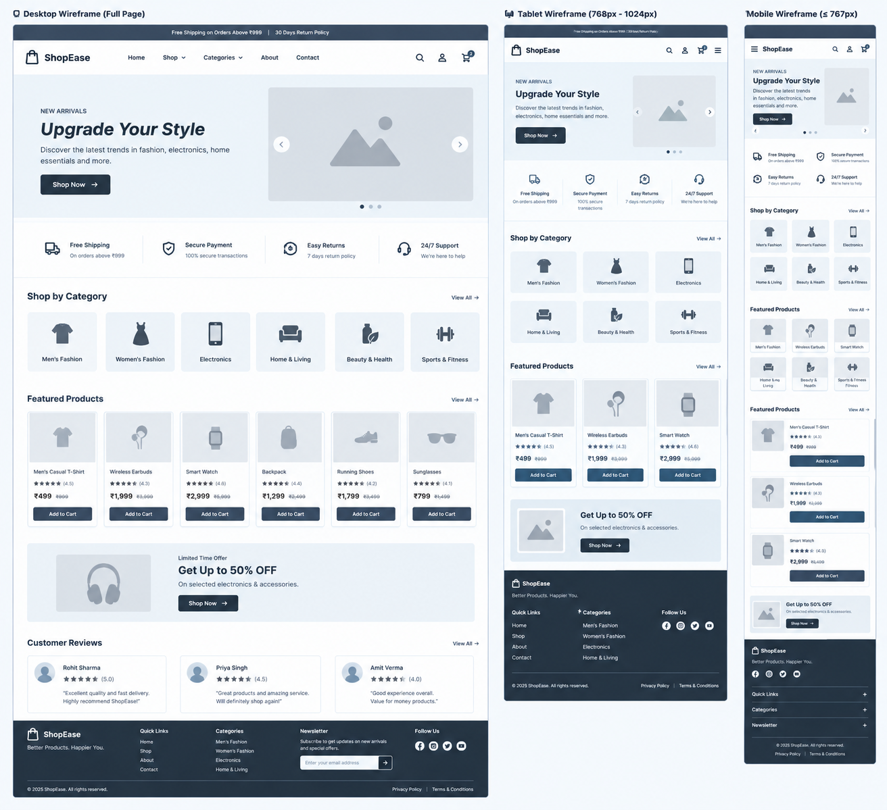

# ShopEase - E-commerce Website

## About the Project

ShopEase is a simple and responsive e-commerce website created using HTML and CSS. The main purpose of this project is to practice web design, page layout, and responsive styling.

The website has a clean design that helps users explore product categories and view featured products.

## Features

- Clean and simple user interface
- Navigation bar with section links
- Hero section with a Shop Now button
- Product categories section
- Featured products with prices and ratings
- Special offers section
- Footer with useful links
- Responsive layout for desktop, tablet, and mobile screens

## Technologies Used

- **HTML5** - To create the structure of the webpage.
- **CSS3** - To style the webpage and make it responsive.

## Project Structure

```text
ShopEase/
│
├── index.html
├── style.css
├── report.md
└── README.md
```

## How to Run the Project

1. Download or clone the project.
2. Open the project folder in VS Code.
3. Make sure `index.html` and `style.css` are in the same folder.
4. Open `index.html` in your browser.
5. Resize the browser window to check the responsive layout.

You can also use the Live Server extension in VS Code to run the website.

## Responsive Design

CSS media queries are used to adjust the layout for different screen sizes. The website layout changes on smaller screens to improve readability and usability.

## Project Purpose

This project was created as a frontend development practice task to improve my understanding of semantic HTML, CSS styling, layout design, and responsive web development.

## Limitations

- This is a static website.
- Product buttons are for display and navigation purposes only.
- The website does not include a functional shopping cart, user login, payment system, or backend.

## Wireframe Screenshot


## Live Link 

https://shopease-task-1.netlify.app/

## Author

Created by **Gyanendra Pandey**

